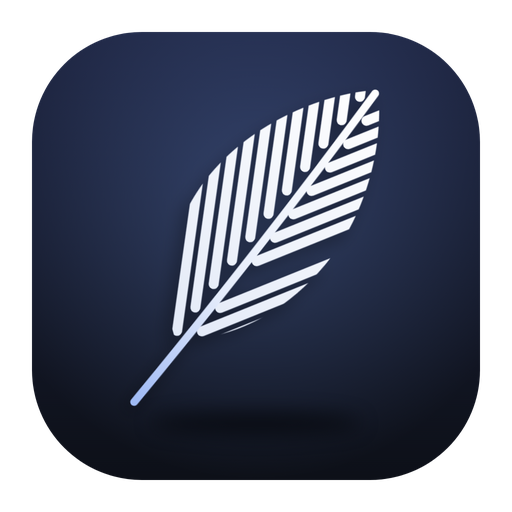
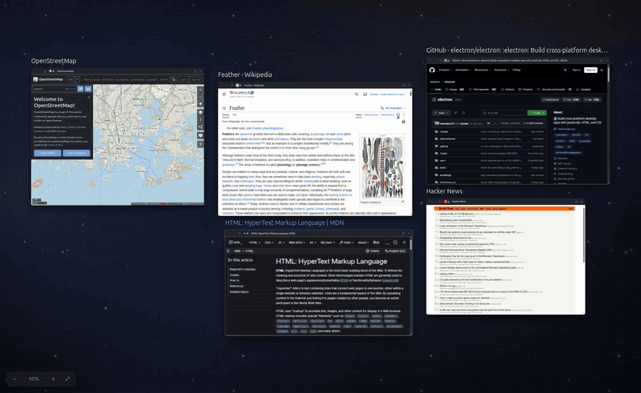
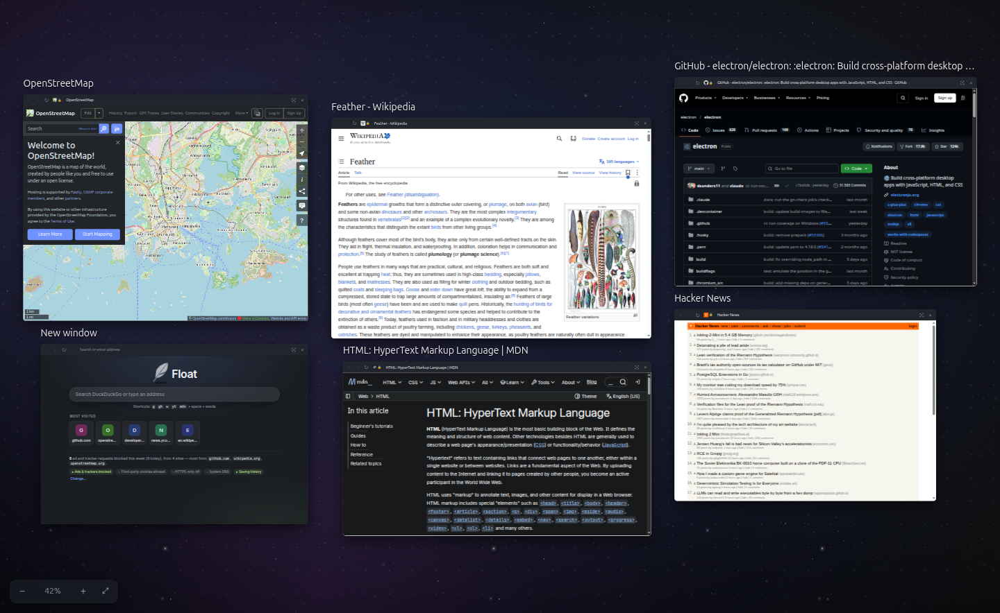
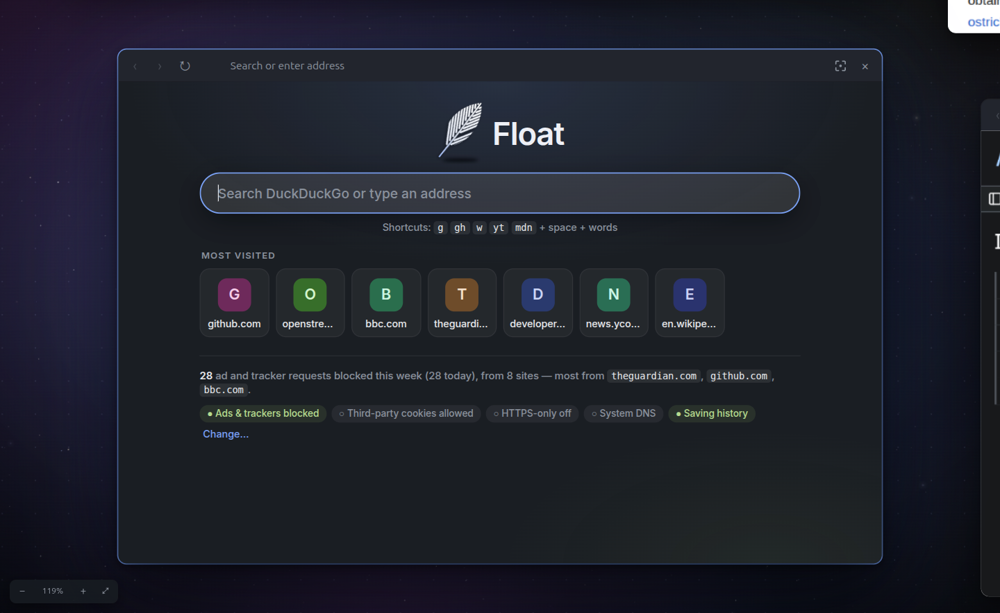
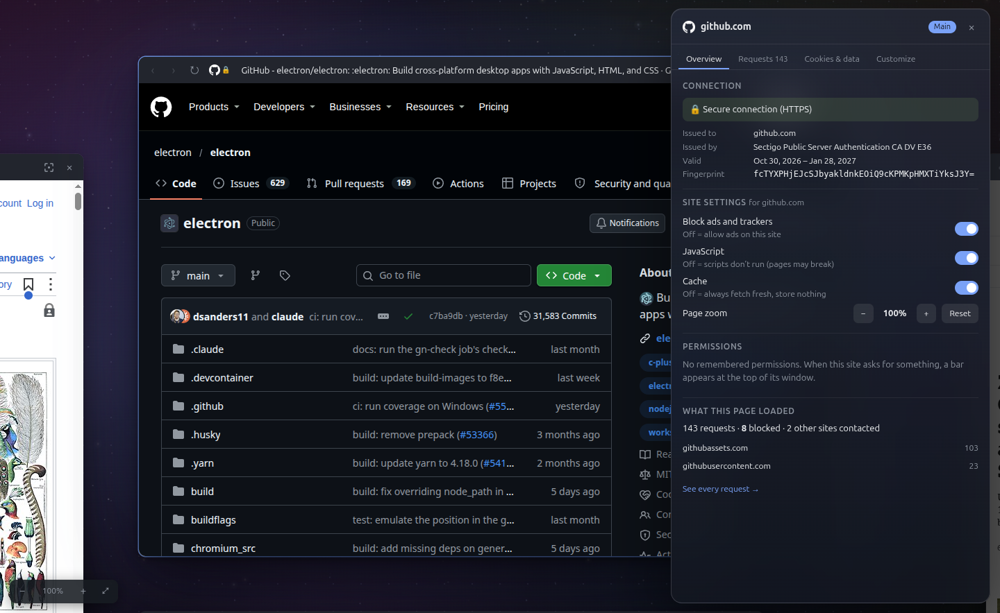
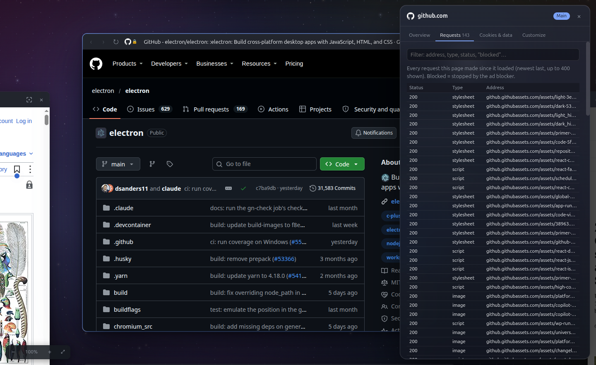
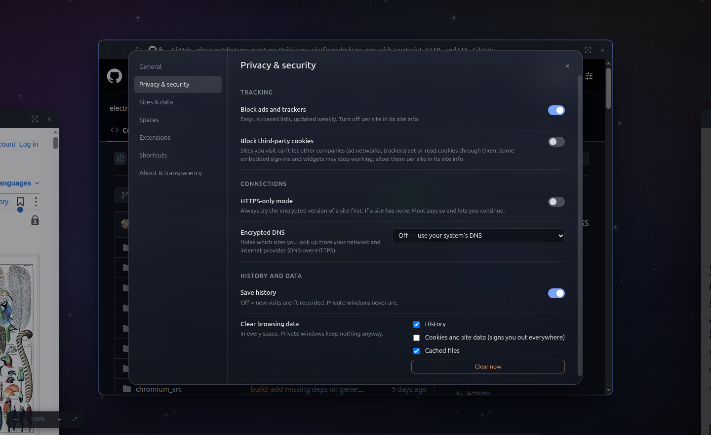
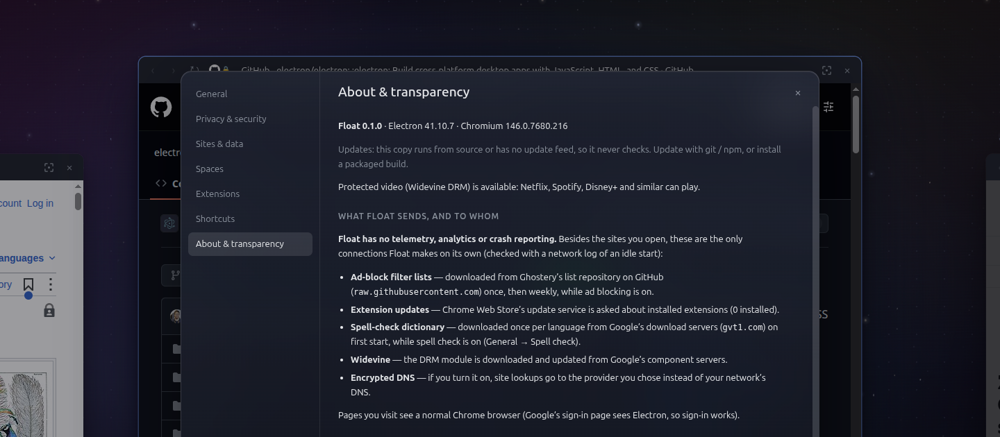

<p align="center">
  
</p>

<h1 align="center">Float</h1>

<p align="center">
  <b>A web browser without tabs.</b> Every page is a window on one infinite canvas.<br>
  Free and open source (MIT) · Linux · no telemetry
</p>

<p align="center">
  <a href="https://buymeacoffee.com/wikssq"></a>
  &nbsp;
  <a href="https://github.com/wiks-sq/float-browser/releases/latest"></a>
</p>

<p align="center">
  
  <br><sub>Recorded in Float, real sites, no editing. <a href="docs/media/demo.mp4">Full-quality video (MP4)</a></sub>
</p>

---

## What Float is

Float replaces tabs with space. Pages open as windows on a canvas you can pan and zoom like a
map. Keep a research topic in one corner and work in another. Zoom out to see everything at
once, and fly to any page with a double-click. Your layout is saved and comes back exactly as
you left it.

It's also a browser that shows its work. For any page, you can see every request it made, what
was blocked, which cookies it stored and which other companies it contacted. Float lists every
connection it makes on its own, and it has no telemetry, analytics or crash reporting.

Under the hood it's Chromium (through Electron), so sites work the way they do in Chrome,
including Netflix, Spotify and Disney+.

## What Float is not

Be clear-eyed before you switch:

- **Not a Chrome replacement in every respect.** There's no sync, and no built-in password
  manager (use Bitwarden from the Chrome Web Store). Extension support is partial (details below).
- **Not hardened like Chrome or Firefox.** Float is built on Electron, which follows Chromium's
  security fixes with some delay. Float updates Electron, but a small project can't match a
  browser vendor's security team. For high-risk browsing, use a mainstream browser.
- **Not an anonymity tool.** Ad and tracker blocking, third-party cookie blocking and encrypted
  DNS reduce tracking. They don't hide you the way Tor does.
- **Not on Windows or macOS (yet).** It's built and tested on Linux. Windows is untested and macOS
  is unsupported; see [Platform status](#platform-status).
- **Not mature.** This is version 0.1, made by one person. Expect rough edges, and please
  [report them](https://github.com/wiks-sq/float-browser/issues).

## Screenshots

| | |
|---|---|
|  **The canvas.** Zoomed out over Wikipedia, GitHub, Hacker News, OpenStreetMap, MDN and a new window. |  **Start page.** Search, most visited sites, and how much was blocked this week. Built from local data only. |
|  **Site info.** Connection and certificate, per-site switches, permissions, and which other sites the page contacted. |  **Requests.** Every request the page made, live, with status, type and what was blocked. |
|  **Privacy & security.** Tracker blocking, third-party cookies, HTTPS-only mode, encrypted DNS. |  **Transparency.** Every connection Float makes on its own, and who to. |

## Install

### Ubuntu / Debian (recommended: `.deb`)

1. Download `float_<version>_amd64.deb` from the
   [latest release](https://github.com/wiks-sq/float-browser/releases/latest).
2. Install it (the `./` matters, or apt looks for a package online):

   ```
   sudo apt install ./float_0.1.0_amd64.deb
   ```

3. Start **Float** from your app menu, or run `float`.

The package installs to `/opt/Float` and adds an AppArmor profile. Ubuntu 24.04 and later need
that profile so Chromium's sandbox can run. To uninstall: `sudo apt remove float`. Your data
stays in `~/.config/Float` until you delete it.

Built and tested on Ubuntu (x86-64). Other Debian-based distributions should work but haven't
been tried.

### Why there's no AppImage

electron-builder's AppImage launcher starts the app with `--no-sandbox` on systems that restrict
user namespaces, such as Ubuntu 24.04. That turns off the protection between web pages and
your computer, and it breaks extensions. Float doesn't ship it. You can still build one
yourself (`npm run dist:appimage`) if you understand that trade-off.

### From source

Needs git and Node.js 22 or newer (Node 20 works too, with engine warnings during install).

```
git clone https://github.com/wiks-sq/float-browser.git
cd float-browser
npm install
npm start
```

`npm install` fetches castLabs' build of Electron, which includes the Widevine module for
protected video. On **Ubuntu 24.04+**, allow that Electron binary to use the sandbox once (run
this from the project folder):

```
sudo tee /etc/apparmor.d/float-dev >/dev/null <<EOF
abi <abi/4.0>,
include <tunables/global>
profile float-dev $PWD/node_modules/electron/dist/electron flags=(unconfined) {
  userns,
  include if exists <local/float-dev>
}
EOF
sudo apparmor_parser -r /etc/apparmor.d/float-dev
```

Please don't work around this with `--no-sandbox`. It removes the protection between web pages
and your system, and extensions stop working.

## Usage

The basics:

- **`Ctrl T`** opens the spotlight. Type an address or a search and press Enter for a new
  window. Press Enter with nothing typed for an empty window with the start page.
- **Drag empty space** to move around. **Ctrl + scroll** or **pinch** to zoom.
- **`Ctrl 0`** shows everything. **Double-click a window** to fly to it.

### Moving around

| Do this | To |
|---|---|
| Drag empty space / middle-drag anywhere | Pan (let go while moving to glide) |
| Scroll / two-finger swipe on empty space | Pan |
| Pinch, or Ctrl + scroll (also over pages) | Zoom the canvas |
| Ctrl + Shift + scroll over a page | Zoom that page's text (remembered per site) |
| Hold **Alt** + drag anywhere | Pan, or move the window under the cursor |
| Hold **Alt** + right-drag a window | Resize it from the nearest corner |
| `Ctrl 0` / `Ctrl 1` / `Ctrl +` / `Ctrl −` | Show everything / 100% / zoom in / zoom out |
| `Alt Shift ←↑→↓` | Jump to the nearest window in that direction |

### Windows

| Do this | To |
|---|---|
| `Ctrl T` | Spotlight: address or search, plus history, places, open windows and commands (↑↓, Enter) |
| `Ctrl Shift N` | New private window |
| `Ctrl Shift F` / the ⤢ button in the title bar | The window fills the screen (canvas hidden); press again to go back exactly where you were |
| Double-click empty space | New empty window right there |
| Right-click empty space | New window here, history, reopen closed, show all, zoom 100% |
| Drag the title bar / an edge or corner | Move / resize |
| Double-click a window that isn't selected | Fly the view to it |
| `Ctrl Tab` / `Ctrl Shift Tab` | Fly to the next / previous window |
| `Ctrl W` · `Ctrl Shift T` | Close · reopen the last closed window |
| `Ctrl L` · `Ctrl R` · `Alt ←/→` · `Ctrl F` | Address bar · reload · back/forward · find in page |
| `Ctrl H` · `Ctrl J` · `Ctrl D` | History · downloads · save this view as a place |
| `Ctrl P` · `Ctrl U` · `F12` · `F11` | Print or save as PDF · view source · devtools · fullscreen |
| Right-click a page → *Pause Window* | Free its memory and keep a snapshot; click to reload |

Every shortcut can be changed in **Settings → Shortcuts** (`Ctrl ,`).

## Features

**Canvas**
- Infinite pan-and-zoom canvas with momentum, and a "show everything" view.
- Your layout is saved and restored on start. Restored windows load only when you go to them,
  so a big canvas stays cheap.
- **Places:** save a view and its windows under a name, then fly back later. Float offers to
  reopen any window you've since closed.
- **Fill the screen** with one window (`Ctrl Shift F` or its title-bar button) when you want to
  focus on a single page, then drop back into the canvas exactly where you left it.
- Pause a window to free its memory. Per-window mute.

**Browsing**
- Chromium engine (Electron 41 / Chromium 146).
- **Protected video (Widevine):** Netflix, Spotify, Disney+ and similar play. On Linux, streaming
  services limit browsers to lower resolutions, the same as in Chrome and Firefox.
- **Start page:** search box, your places, most-visited sites, and this week's blocking count.
  Built from local data only. Or choose an empty window or any page of your own.
- Search engine and keywords of your choice (`gh electron` searches GitHub, for example).
- **Downloads** with progress, pause and resume, and retry. Print and save as PDF, spell check,
  per-site page zoom, view source.
- A crashed page says so in its window and offers to reload.
- Google sign-in works.

**Privacy and control**
- **Ad and tracker blocking** (Ghostery's engine, EasyList-based lists, refreshed weekly).
  Turn it off per site.
- **Block third-party cookies** (optional), for requests and `document.cookie` alike. Allow per
  site when an embedded login needs them.
- **HTTPS-only mode** (optional). When a site has no HTTPS version, Float says so and lets you
  continue.
- **Encrypted DNS** (DNS-over-HTTPS): Cloudflare, Quad9, Google, Mullvad or a custom provider,
  with a "secure only" option.
- **Spaces:** separate cookie jars, for example Work and Personal Google accounts side by side,
  each with its own colour.
- **Private windows** keep nothing: no history, no saved layout, and cookies are wiped when the
  last one closes.
- **Site info** per page: certificate, permissions, per-site switches (ads, JavaScript, cache,
  third-party cookies), every request, cookie names (values stay hidden), and *Clear data for
  this site*.
- **Your own CSS and JavaScript** per site.
- A full-page warning for certificate errors. *Proceed anyway* is remembered for that exact
  certificate only.

**Extensions**
- Install from the Chrome Web Store (spotlight → `store`, then **Add to Float**). Settings shows
  what each extension can access and turns each one on or off.
- Electron implements only part of Chrome's extension APIs, so not every extension works.
  `declarativeNetRequest` blockers like uBlock Origin Lite don't block anything (the built-in
  blocker covers that). **Bitwarden** installs and runs, and its popup opens. Logging in and
  autofill haven't been tested yet.
- Extensions run in the main space only.

## What Float sends, and to whom

Float has **no telemetry, analytics or crash reporting**. Besides the sites you open, these are
the only connections it makes on its own. They were checked with a network log of an idle start,
and Settings → About & transparency lists them too.

- **Ad-block filter lists:** downloaded from Ghostery's list repository on GitHub
  (`raw.githubusercontent.com`), once and then weekly, while blocking is on.
- **Extension updates:** the Chrome Web Store update service is asked about extensions you
  installed.
- **Spell-check dictionary:** downloaded once per language from Google's servers, while spell
  check is on.
- **Widevine:** Google's component servers deliver and update the DRM module.
- **Update checks** (`.deb` installs only): GitHub Releases is asked for the latest version at
  start and every 6 hours. You can turn this off in Settings. Updates download only when you click.
- **Encrypted DNS:** if you turn it on, site lookups go to the provider you chose.

Everything Float stores is in plain files in `~/.config/Float`: settings, history, places,
permissions, your canvas, and the start page's blocking counts (kept 7 days). Settings has an
*Open data folder* button.

## Platform status

| Platform | Status |
|---|---|
| **Linux** (Ubuntu 24.04+, x86-64) | Developed and tested. `.deb` package with auto-update. |
| **Windows** | **Untested.** An installer target is configured and the code has no Linux-only parts, but nobody has run Float on Windows yet. Reports welcome. |
| **macOS** | **Not supported.** No build target, never run. |

## Known limitations

- **Updates:** the update check and notice work, but installing an update hasn't been tested end
  to end, because there's only one release so far.
- **Netflix and others on Windows** would need the build to be signed with castLabs' EVS service
  (the Windows build does this; see below). That's untested, like the rest of Windows.
- **No sync, no reading mode, no built-in password manager.**

## Building

```
npm install
npm run dist            # dist/float_<version>_amd64.deb (+ latest-linux.yml for updates)
npm run dist:appimage   # AppImage; see "Why there's no AppImage" above
```

Packages use the Electron installed in `node_modules` (castLabs' build, for Widevine).

**Windows installer (untested).** Build it on Windows, because the build packages the
platform-specific Electron in `node_modules`:

```
pip install --upgrade castlabs-evs
python -m castlabs_evs.account signup      # free; once
npm run dist:win                           # dist\Float-Setup-<version>.exe
```

The build signs Float with castLabs EVS (VMP), which Netflix and Disney+ require on Windows.
Without an EVS account, set `FLOAT_SKIP_EVS=1`: the installer still works, but protected video
won't. The installer isn't Authenticode-signed, so SmartScreen will warn.

**Logo:** `build/make-logo.py` generates `build/logo.svg` and `assets/logo-mark.svg`.

## Support Float

Float is free and always will be. If it's useful to you, you can support its development:

<p>
  <a href="https://buymeacoffee.com/wikssq"></a>
</p>

Bug reports and ideas are just as welcome: [open an issue](https://github.com/wiks-sq/float-browser/issues).

## License and credits

Float is released under the [MIT License](LICENSE).

It builds on:
- [Electron](https://www.electronjs.org/) and [castLabs Electron for Content Security](https://github.com/castlabs/electron-releases) (MIT).
- [Ghostery adblocker](https://github.com/ghostery/adblocker) (MPL-2.0).
- [electron-chrome-extensions and electron-chrome-web-store](https://github.com/samuelmaddock/electron-browser-shell) (MIT).
- [electron-builder / electron-updater](https://www.electron.build/) (MIT).
- [tldts](https://github.com/remusao/tldts) (MIT).
- The [Inter](https://rsms.me/inter/) typeface (SIL Open Font License, `assets/fonts/Inter-LICENSE.txt`).

The Widevine module is Google's proprietary software. It's downloaded by Electron at runtime and
isn't part of this repository.
